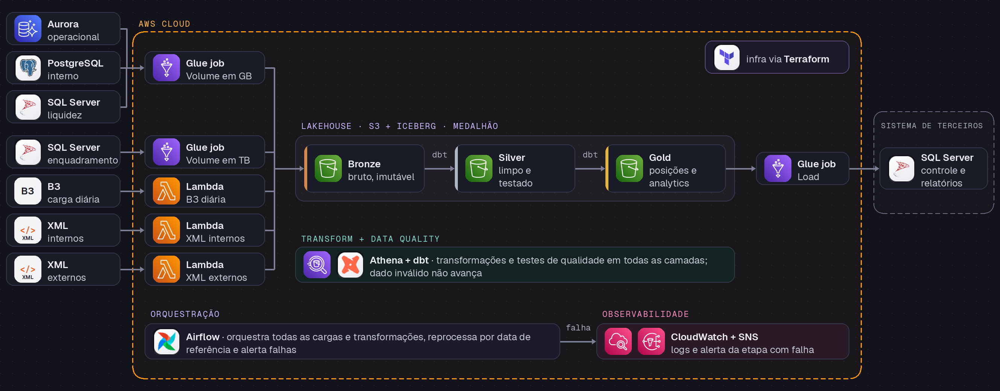

<div align="center">

# Risk & Liquidity Data Platform

**De sete fontes desconectadas a dados confiáveis de liquidez e enquadramento,<br>com qualidade validada antes de qualquer publicação.**

[](https://github.com/Anderson-adm/enterprise-risk-liquidity/actions/workflows/ci.yml)


[Case no portfólio](https://anderson-adm.github.io/data-engineer-portfolio-site/cases/risk-liquidity.html) · [Arquitetura](#a-solução) · [Como rodar](#explore-em-poucos-comandos)

</div>

## Em 30 segundos

- **Desafio:** dados de risco, liquidez e enquadramento espalhados em sete fontes. Conciliar
  levava uma semana e cobria só liquidez.
- **Meu papel:** atuar junto às áreas de negócio para entender as demandas e validar fontes e
  recursos; desenhar a arquitetura; construir a solução de ponta a ponta e conduzir a
  sustentação e as melhorias contínuas.
- **Solução:** lakehouse medalhão na AWS com ingestão por padrão, dbt com testes como portão de
  qualidade e publicação transacional no sistema consumidor.
- **Resultado (caso original):** −80% no tempo de disponibilizar dados validados, com liquidez
  e enquadramento na mesma base.

## O desafio

**Os dados existiam. Uma visão confiável e no prazo, não.**

Em uma operação de administração de fundos, responder **quanto cada carteira tem de liquidez e
se respeita os limites de concentração** exige combinar posições, caixa, resgates, preços e
cadastros. Esses dados chegavam de **sete fontes heterogêneas**, em formatos e horários
diferentes, com identificadores nem sempre compatíveis.

No caso real que inspirou este projeto, a conciliação levava cerca de uma semana, cobria apenas
parte da necessidade do negócio e ainda precisava alimentar um novo sistema de controle e
relatórios regulatórios.

| O problema | Por que importava |
|:--|:--|
| **Uma semana para conciliar** | Informação disponível tarde demais para decisões e controles. |
| **Números divergentes** | A mesma carteira identificada de formas diferentes entre sistemas. |
| **Cobertura incompleta** | Liquidez sem a mesma visão consolidada de enquadramento. |
| **Prazo e rastreabilidade** | Um erro não podia chegar ao sistema consumidor sem ser percebido. |

O desafio de engenharia não era apenas mover dados: era **reconciliar, validar, reprocessar
datas passadas e publicar com segurança**, sem perder a última versão correta quando uma carga
falhasse.

## O resultado

| −80% no tempo | 7 fontes | 2 domínios |
|:--:|:--:|:--:|
| de cerca de uma semana para um dia na disponibilização de dados validados | integradas em uma base única | liquidez e enquadramento na mesma camada Gold |

> **Importante:** esses indicadores pertencem ao caso original. Esta reconstrução usa dados,
> fontes e regras totalmente sintéticos.

**Nesta reconstrução**, o resultado pode ser inspecionado no código: um pipeline reproduzível
com dois produtos Gold, publicação transacional, cenários de falha e reprocessamento testados,
nove unidades independentes e CI verde.

## A solução

**Um lakehouse com qualidade antes da publicação.**



1. **Ingestão por padrão.** Bancos entram por jobs do Glue, perfilados por volume (GB e TB);
   dados de mercado e os dois tipos de XML entram por Lambdas, uma por fonte.
2. **Bronze.** Cada entrega fica imutável, com manifesto, checksum, detecção de duplicidade e
   quarentena para arquivos inválidos.
3. **Silver e Gold.** O dbt reconcilia identificadores e constrói os produtos de liquidez e de
   enquadramento. Os testes de qualidade decidem se a Gold pode ser promovida.
4. **Publicação protegida.** A Gold auditada é exportada como pacote e carregada no SQL Server
   em uma única transação, preservando a versão anterior se algo falhar.
5. **Operação.** Airflow orquestra por data de referência; CloudWatch e SNS alertam a etapa que
   falhou; Terraform define a infraestrutura.

**Decisões de engenharia**

- **Ingestão por padrão, não por fonte.** Uma fonte nova reaproveita um padrão existente.
- **Qualidade como portão.** Dado inválido não chega ao consumidor: fica em quarentena para
  análise, e a última versão válida continua publicada.
- **Reprocessamento idempotente.** Rodar a mesma data de novo não duplica nada.
- **dbt sobre Athena em vez de jobs Spark por camada.** Transformações em SQL versionado, com
  testes, documentação e linhagem, e menos código Spark para manter.
- **Pacote entre a Gold e o SQL Server.** A nuvem não acessa o banco do consumidor
  diretamente, sem VPN nem exposição de rede; a transação final acontece do lado do consumidor.

### Quando algo dá errado

| Situação | Comportamento |
|:--|:--|
| XML malformado ou fora do XSD | Arquivo vai para quarentena com o motivo da rejeição. |
| Identificadores divergentes e duplicidades | Reconciliação por mapeamento; rejeições rastreáveis. |
| Mesma carga executada de novo | Nada é duplicado; a publicação idêntica é ignorada. |
| Falha crítica de qualidade | Gold e consumidor mantêm a última versão válida. |
| Falha no meio da publicação | Rollback da transação; nenhuma versão parcial é exposta. |
| Publicadores concorrentes | Serializados por trava; exatamente uma versão ativa. |

## Engenharia para evoluir sem quebrar tudo

O projeto é organizado em **nove unidades autônomas**: integrações criadas em momentos
diferentes podem mudar, ser substituídas ou sair sem refatorar as demais. Cada Glue e Lambda
tem código e build próprios, sem acoplar duas integrações só porque hoje se parecem.

```text
apps/
  hybrid-runner/          # extração SQL, CLI e orquestração local
  publisher/              # publicação transacional no SQL Server
  source-generator/       # fontes e cenários sintéticos
glue/
  extract-liquidez/       # snapshot de bancos, perfil GB
  extract-enquadramento/  # snapshot de bancos, perfil TB
  export-risk-analytics/  # pacote de publicação dos produtos Gold
lambda/
  market-data/            # CSV de dados de mercado
  internal-xml/           # XML interno
  external-xml/           # XML externo
dbt/                      # staging, Silver, Gold e testes
airflow/                  # orquestração do pipeline
infra/                    # Terraform
```

## Explore em poucos comandos

Executa a reconstrução localmente, sem provisionar recursos na AWS. Requer Python 3.12
gerenciado pelo [uv](https://docs.astral.sh/uv/).

```bash
uv sync
cp .env.example .env

# Gerar fontes sintéticas e arquivos de entrada
uv run erl generate

# Executar uma data de referência
uv run erl run --date 2026-10-26

# Consultar o histórico de publicações
uv run erl publications
```

Testes e builds:

```bash
uv run ruff check apps protocols contracts tests airflow glue lambda scripts
uv run pytest -m "not dbt and not integration"
DBT_SEND_ANONYMOUS_USAGE_STATS=false uv run pytest -m "dbt and not integration"

# Construir os artefatos de cada unidade e rodar os smoke tests
uv run python scripts/build/build_artifacts.py --prepare-wheels
uv run python scripts/build/build_artifacts.py
uv run python scripts/build/smoke_artifacts.py
```

---

<div align="center">

**Anderson Nascimento** · Data Engineer<br>
[Portfólio](https://anderson-adm.github.io/data-engineer-portfolio-site/) · [LinkedIn](https://www.linkedin.com/in/anderson-santos-do-nascimento)

</div>
