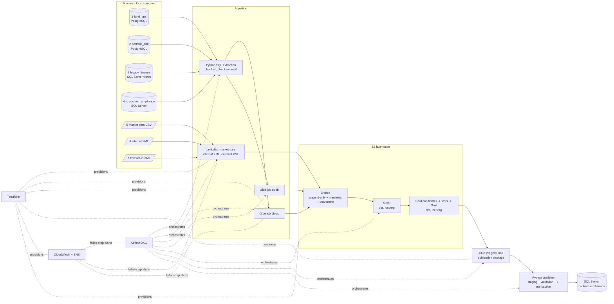

# Enterprise Risk & Liquidity Data Platform (Case 01)

An authorial, reproducible reconstruction of a financial data-integration problem: seven
heterogeneous sources are integrated into validated **liquidity** and **exposure/compliance**
products and published, transactionally and idempotently, to a SQL Server reporting system.
All data, codes, limits and rules are **synthetic**; nothing comes from any real company.

> Status labels used throughout: **Validated locally** · **Validated on AWS** ·
> **Implemented, not validated** · **Planned**. Nothing in this repository has been validated
> on AWS yet.

## 1. Business problem

A fund administrator needs, for every business date, one consistent answer to "how liquid is
each portfolio and does it respect its concentration limits?", delivered to the control and
reporting system — even though positions, cash, redemptions, prices and registers live in
different systems that disagree on identifiers and deliver at different times.

## 2. Engineering problem

Integrate databases, legacy views, a daily CSV and two XML formats; normalise identifiers;
handle late and corrected deliveries; deduplicate; reconcile; let any date be reprocessed
safely; stop invalid data before it reaches the consumer; and keep the last valid version
when something fails — with traceability from every published number back to the delivery it
came from.

## 3. Architecture



| Component | How it is implemented | Status |
|---|---|---|
| 7 sources | SQLAlchemy schemas for 4 DBs + CSV + 2 XML/XSD formats, deterministic generator | Validated locally on SQLite stand-ins; PostgreSQL/SQL Server containers **implemented, not validated** (no container runtime was running) |
| Extraction | parameterised SQL, streamed in chunks, landing snapshot + manifest | Validated locally |
| Bronze | run-scoped keys, conditional writes, checksums, duplicate detection, quarantine | Validated locally (filesystem) and with moto (S3 API mock) |
| Lambdas (CSV / XML ingestion) | `erl.aws.lambda_handlers` → same code as local ingestion | Handler logic validated with moto; **AWS execution not validated** |
| Glue jobs db-gb / db-tb / gold-load | PySpark (Glue 5.0) scripts in `glue/jobs` | **Implemented, not validated** (no Spark/AWS run) |
| Silver / Gold | dbt, portable SQL, DuckDB locally; Athena + Iceberg target configured | Validated locally on DuckDB; **Athena/Iceberg not validated** |
| Quality gate | dbt tests on write-audit-publish candidates + gate step | Validated locally |
| Publication | staging, in-DB checks, single transaction, content-hash idempotency, publication log | Validated locally on SQLite; SQL Server **implemented, not validated** |
| Airflow | local Airflow 3.3.2, one task per step, retries, alerts, failure watcher | Validated locally (`airflow dags test`, success and failure runs) |
| CloudWatch / SNS | log groups, Lambda error alarms, Glue failure EventBridge rule, DAG failure → SNS | **Implemented, not validated** (locally the alert is a structured log line) |
| Terraform | bootstrap + dev root module + 1 module | fmt/validate/TFLint/Checkov/`terraform test` (mocked) pass; **never applied** |
| CI | GitHub Actions (Python, dbt on DuckDB, Terraform checks), actions pinned by SHA | Written; not yet run on GitHub |

Why a publication package between Gold and SQL Server: AWS must not connect to a local
database (no VPN/NAT, nothing exposed). The Glue `gold-load` job exports the audited Gold rows
of the run to S3; the local publisher performs the transactional SQL Server load. In an
enterprise network the same job would write through a Glue JDBC connection.

## 4. The seven sources and 5. the model

See [docs/DATA_MODEL.md](docs/DATA_MODEL.md): sources, identifier crosswalk, layers, snapshot
semantics, rejection reasons, the synthetic liquidity and concentration rules (with a worked
example) and the critical tests.

## 6. Start the environment

Requirements: [uv](https://docs.astral.sh/uv/), Python 3.12 (uv installs it), Terraform ≥ 1.10
for the infra checks. Docker is optional (see [docs/LOCAL_RUNTIME.md](docs/LOCAL_RUNTIME.md)).

```bash
uv sync                       # locked dependencies (uv.lock)
cp .env.example .env          # defaults: ERL_MODE=local, ERL_SOURCE_BACKEND=sqlite
```

## 7. Generate data

```bash
uv run erl generate           # 4 source databases + inbox files for 2026-10-26..28
```

## 8. Run the pipeline

```bash
uv run erl run --date 2026-10-26        # all steps; prints run id, step status, report path
uv run erl publications                 # consumer publication log
# Airflow (separate venv, SQLite metadata):
scripts/airflow_local.sh setup && scripts/airflow_local.sh test 2026-10-26
```

Exit codes: 0 ok, 2 configuration, 3 infrastructure/source unavailable, 4 contract,
5 quality gate, 6 publication. Each run writes `data/runs/<run_id>/state.json`,
`run_report.json` and dbt artefacts; logs are JSON lines in `data/logs/erl.jsonl`.

## 9. Tests

```bash
uv run ruff check src tests airflow glue scripts
uv run pytest -m "not dbt and not integration"   # unit/contract/moto tests (~1 min)
uv run pytest -m "dbt and not integration"       # 9 end-to-end scenarios with dbt (~4 min)
ERL_IT_CONTAINERS=1 uv run pytest -m integration # needs docker/compose.yaml running
cd infra && terraform -chdir=environments/dev test   # mocked provider, plan only
```

## 10. Query the results

On SQL Server the tables are `rpt.liquidity_summary`, `rpt.exposure_compliance` and
`rpt.publication_log` (SQLite stand-in: same names without schema).

```sql
SELECT reference_date, portfolio_id, total_value, liquid_value, liquidity_ratio,
       pending_redemptions, redemption_coverage
FROM rpt.liquidity_summary WHERE reference_date = '2026-10-27' ORDER BY portfolio_id;

SELECT portfolio_id, top_issuer_code, top_issuer_pct, concentration_check,
       reconciliation_status, quality_status
FROM rpt.exposure_compliance WHERE reference_date = '2026-10-28';

SELECT reference_date, publication_id, status, superseded_by, message
FROM rpt.publication_log ORDER BY reference_date, published_at;
```

Real output of these queries (local evidence run, SQLite stand-in) is in
[evidence/local/consumer_queries.txt](evidence/local/consumer_queries.txt), e.g.:

```
reference_date | portfolio_id | total_value | liquid_value | liquidity_ratio | pending_redemptions | redemption_coverage
2026-10-27     | PRT-0003     | 7970108.04  | 6818558.87   | 0.855516        | 9500000.00          | 0.717743
2026-10-27     | PRT-0004     | 5152655.79  | 1383223.63   | 0.268449        | 1200000.00          | 1.152686
```

## 11. Failures and reprocessing

`uv run python scripts/collect_evidence.py` replays all scenarios from scratch; results are in
[evidence/local/](evidence/local/).

| Scenario | Command | Observed outcome |
|---|---|---|
| Divergent identifiers, duplicates, unmapped portfolio | `erl run --date 2026-10-27` | resolved via crosswalk; `DUPLICATE_RECORD` ×2, `UNMAPPED_PORTFOLIO` ×2 in `silver_rejected_records` |
| Invalid XML (malformed, XSD) | same run | both files quarantined with `.rejection.json`; PRT-0008 missing → completeness warning; D2 published with 7 portfolios |
| Late reference date | `erl run --date 2026-10-28` then `--date 2026-10-27` | D2 retransmission lands in the D2 partition (`late_arrival`); D2 reprocess publishes 8 portfolios, previous version `SUPERSEDED` |
| Re-execution of the same load | `erl run --date 2026-10-27` again | every snapshot `DUPLICATE`; publication `SKIPPED_IDENTICAL` |
| Correction of a published position | `erl scenario correct-position --date 2026-10-28` + run | new version published; reconciliation flags PRT-0001 `MISMATCH` (risk corrected, compliance not) |
| Critical quality failure | `erl scenario degrade-market-data --date 2026-10-28` + run | gate fails (rejection ratio); both Gold tables untouched; consumer keeps the last valid version; exit code 5 |
| Source unavailable | `erl scenario remove-market-data --date 2026-10-26` + run | `source_unavailable` at collect, exit code 3, report still produced |
| Failure mid-publication | `tests/test_publisher.py` (fault injection) | transaction rolled back, previous version intact, `FAILED` log row |

## 12. Optional AWS run and 13. teardown

Procedure, authorisation points, evidence list and teardown: [docs/AWS_VALIDATION.md](docs/AWS_VALIDATION.md).
Terraform design, ownership, security controls, Checkov exceptions and cost model:
[docs/TERRAFORM.md](docs/TERRAFORM.md). Apply and destroy are never run by scripts.

## 14. Limitations

* No container runtime was running, so PostgreSQL/SQL Server were replaced by SQLite stand-ins
  (same SQLAlchemy code and SQL). Dialect-specific behaviour (SQL Server locking/types, Postgres
  streaming) is covered only by the opt-in integration test, which has not been executed.
* Athena/Iceberg, Glue, Lambda on AWS, CloudWatch and SNS have not been executed. dbt SQL is
  written in the DuckDB/Trino common subset with engine differences isolated in
  `dbt/macros/platform.sql`, but Athena compilation/execution is unverified.
* On Athena the Gold upsert (`merge`) does not delete rows that vanish upstream; the Load step
  exports only rows written by the current run, so such rows are never published.
* Silver is rebuilt from Bronze on every run (small data). A degraded delivery therefore also
  changes Silver until a corrected delivery arrives; Gold and the consumer are protected by the
  gate.
* Liquidity and concentration rules are synthetic demonstrations, not regulatory calculations.
* Volumes are tiny by design; no performance claims are made. Historical results mentioned on the
  portfolio site (e.g. "-80% time to deliver") are **not** measured by this reconstruction.

## 15. Evidence

* [evidence/local/summary.json](evidence/local/summary.json) — the 8 scenarios, statuses and
  measured wall-clock times (≈40 s per successful local run on WSL2/`/mnt/c`, dominated by dbt).
* [evidence/local/runs/](evidence/local/runs/) — full run reports (records read, ingestion
  statuses, quarantined files, gate result, publication, rejected records, step timings).
* [evidence/local/consumer_queries.txt](evidence/local/consumer_queries.txt) — consumer tables
  and publication log.
* [evidence/local/pytest.txt](evidence/local/pytest.txt), [evidence/terraform/checks.txt](evidence/terraform/checks.txt).

Project working agreements for humans and coding agents: [AGENTS.md](AGENTS.md).
Handoff state: [docs/HANDOFF.md](docs/HANDOFF.md).
