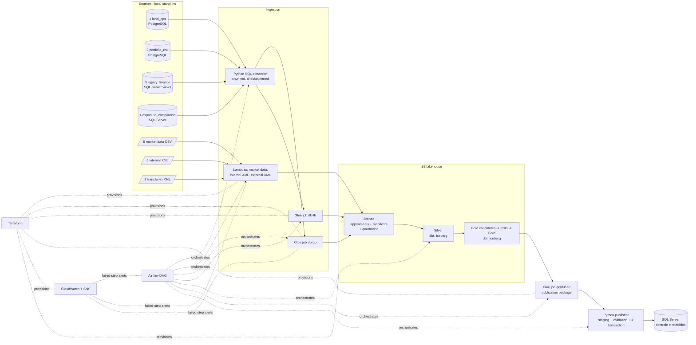

# Enterprise Risk & Liquidity Data Platform (Case 01)

An authorial, reproducible reconstruction of a financial data-integration problem: seven
heterogeneous sources are integrated into validated **liquidity** and **exposure/compliance**
products and published, transactionally and idempotently, to a SQL Server reporting system.
All data, codes, limits and rules are **synthetic**; nothing comes from any real company.

> Status labels used throughout: **Validated locally** · **Validated on AWS** ·
> **Implemented, not validated** · **Planned**. **AWS provisioning and teardown were validated.**
> The first functional run failed in Lambda on a missing Zstandard codec; the complete AWS
> pipeline is **not validated**. All Case 01 AWS resources were subsequently deleted.
> Since then (2026-10-30, offline): the codec and single-date generator defects are fixed and
> covered by tests, the code follows a documented layout ([REFACTORING.md](docs/REFACTORING.md)),
> and the deployable artifacts are built and smoke-tested before Terraform. Units now own their implementations and deploy artifacts; see the ownership map below. None of this has
> been deployed or run on AWS.

Current record: [handoff](docs/HANDOFF.md), [failed AWS run](evidence/aws/functional/2026-10-26/summary.json),
[teardown](evidence/aws/teardown/verification.json), [expanded account cleanup](evidence/aws/account-cleanup/verification.json).
Copyable project context for another AI discussion: [PROJECT_CONTEXT_PROMPT.md](docs/PROJECT_CONTEXT_PROMPT.md).

## 1. Business problem

A fund administrator needs, for every business date, one consistent answer to "how liquid is
each portfolio and does it respect its concentration limits?", delivered to the control and
reporting system — even though positions, cash, redemptions, prices and registers live in
different systems that disagree on identifiers and deliver at different times.

## 2. Engineering problem

Integrate databases, legacy views, a daily CSV and two XML formats; normalise identifiers;
handle late and corrected deliveries; deduplicate; reconcile; let any date be reprocessed
safely; stop invalid data before it reaches the consumer; and keep the last valid version
when something fails — with traceability from every published number back to the delivery it
came from.

## 3. Architecture



| Component | How it is implemented | Status |
|---|---|---|
| 7 sources | SQLAlchemy schemas for 4 DBs + CSV + 2 XML/XSD formats, deterministic generator | Validated locally on PostgreSQL 17 + SQL Server 2022 containers and on SQLite stand-ins |
| Extraction | parameterised SQL, streamed in chunks, landing snapshot + manifest | Validated locally on PostgreSQL, SQL Server (incl. legacy views) and SQLite; identical content hashes across engines |
| Bronze | run-scoped keys, conditional writes, checksums, duplicate detection, quarantine | Validated locally (filesystem) and with moto (S3 API mock) |
| Lambdas (CSV / XML ingestion) | per-function handlers/parsers in `lambda/<unit>`; own ZIP with pinned PyArrow (and lxml for XML), versioned integrity protocol (no managed layer) | built ZIP smoke-tested locally (isolated interpreter, moto S3, Zstandard round-trip); the one AWS invocation (old package) **failed** on the managed layer's codec; the fix is **not validated on AWS** |
| Glue jobs db-gb / db-tb / gold-load | unit-local entry points/Spark code in `glue/{db-gb,db-tb,gold-load}` + independent library per job via `--extra-py-files` | **Implemented, not validated**: library imports and non-Spark steps smoke-tested from the built ZIP; no Spark (no local JVM) and no AWS run |
| Silver / Gold | dbt, portable SQL, DuckDB locally; Athena + Iceberg target configured | Validated locally on DuckDB; **Athena/Iceberg not validated** |
| Quality gate | dbt tests on write-audit-publish candidates + gate step | Validated locally |
| Publication | staging, in-DB checks, single transaction, content-hash idempotency, publication lock, publication log | Validated locally on a SQL Server 2022 container (incl. concurrent publishers) and on SQLite |
| Airflow | local Airflow 3.3.2, one task per step, retries, alerts, failure watcher | Validated locally on PostgreSQL + SQL Server (`airflow dags test`, success and quality-failure runs) |
| CloudWatch / SNS | log groups, Lambda error alarms, Glue failure EventBridge rule, DAG failure → SNS | Real Lambda error logs and successful alarm action to SNS observed; human receipt and other alert paths not verified |
| Terraform | bootstrap + dev root module + 1 module; uploads pre-built artifacts to a separate artifacts bucket | local checks pass (fmt, validate, 15 mocked tests, TFLint, Checkov 162/0/40); the earlier layout was applied (7 bootstrap + 69 dev) and fully destroyed; the current layout was **never applied** |
| CI | GitHub Actions (Python, dbt on DuckDB, PostgreSQL + SQL Server integration, per-unit build/smoke, Terraform checks), actions pinned by SHA | Historical baseline green; autonomous-unit changes checked locally, not pushed |

Why a publication package between Gold and SQL Server: AWS must not connect to a local
database (no VPN/NAT, nothing exposed). The Glue `gold-load` job exports the audited Gold rows
of the run to S3; the local publisher performs the transactional SQL Server load. In an
enterprise network the same job would write through a Glue JDBC connection.

Code layout (details and rationale: [docs/REFACTORING.md](docs/REFACTORING.md)):

| Path | Responsibility |
|---|---|
| `apps/hybrid-runner/` | existing CLI, configuration/checkpoints, SQL extraction and orchestration; own extraction SQL |
| `apps/publisher/` | package validation/export and transactional publication; own consumer SQL |
| `apps/source-generator/` | synthetic source systems and scenarios; public configuration/connection interface |
| `lambda/{market-data,internal-xml,external-xml}/` | each function owns its handler, parser, dependencies and ZIP |
| `glue/{db-gb,db-tb,gold-load}/` | each job owns its entry point, native Spark operations, requirements and script/library artifacts |
| `contracts/` | published JSON/XSD/source-schema interfaces |
| `protocols/integrity-v2/` | pinned 2.0.0 integrity exception, vendored per artifact; no mutable shared runtime ZIP |
| `scripts/build` → `dist/<runtime>/<unit>/` | independent artifacts/manifests (SHA-256, commit, runtime), built offline from cached dependencies before planning |


## 4. The seven sources and 5. the model

See [docs/DATA_MODEL.md](docs/DATA_MODEL.md): sources, identifier crosswalk, layers, snapshot
semantics, rejection reasons, the synthetic liquidity and concentration rules (with a worked
example) and the critical tests.

## 6. Start the environment

Requirements: [uv](https://docs.astral.sh/uv/), Python 3.12 (uv installs it), Terraform ≥ 1.10
for the infra checks. Docker is optional (see [docs/LOCAL_RUNTIME.md](docs/LOCAL_RUNTIME.md)).

```bash
uv sync                       # locked dependencies (uv.lock)
cp .env.example .env          # defaults: ERL_MODE=local, ERL_SOURCE_BACKEND=sqlite
```

## 7. Generate data

```bash
uv run erl generate           # 4 source databases + inbox files for 2026-10-26..28
```

Scenario roles are positional over strictly increasing dates: the first date is clean (D1), the
second carries the D2 problems, the third the late arrival. `erl generate --dates 2026-10-26`
now produces only the clean D1 slice (the defect that aliased D2 fixtures onto D1 was fixed on
2026-10-30; `tests/test_synthetic_generation.py`).

## 8. Run the pipeline

```bash
uv run erl run --date 2026-10-26        # all steps; prints run id, step status, report path
uv run erl publications                 # consumer publication log
# Airflow (separate venv, SQLite metadata):
scripts/airflow_local.sh setup && scripts/airflow_local.sh test 2026-10-26
```

Exit codes: 0 ok, 2 configuration, 3 infrastructure/source unavailable, 4 contract,
5 quality gate, 6 publication. Each run writes `data/runs/<run_id>/state.json`,
`run_report.json` and dbt artefacts; logs are JSON lines in `data/logs/erl.jsonl`.

## 9. Tests

```bash
uv run ruff check apps protocols contracts tests airflow glue lambda scripts
uv run pytest -m "not dbt and not integration"   # unit/contract/moto/layout tests (~2 min)
DBT_SEND_ANONYMOUS_USAGE_STATS=false uv run pytest -m "dbt and not integration"       # 11 end-to-end regression cases with dbt
uv run python scripts/build/build_artifacts.py && uv run python scripts/build/smoke_artifacts.py
# real PostgreSQL + SQL Server (docker/compose.yaml running, .env with local passwords):
set -a; . ./.env; set +a; ERL_IT_CONTAINERS=1 uv run pytest -m integration   # ~1.5 min
scripts/terraform_checks.sh   # fmt, validate, mocked tests, TFLint, Checkov - on a copy, no credentials
```

## 10. Query the results

On SQL Server the tables are `rpt.liquidity_summary`, `rpt.exposure_compliance` and
`rpt.publication_log` (SQLite stand-in: same names without schema).

```sql
SELECT reference_date, portfolio_id, total_value, liquid_value, liquidity_ratio,
       pending_redemptions, redemption_coverage
FROM rpt.liquidity_summary WHERE reference_date = '2026-10-27' ORDER BY portfolio_id;

SELECT portfolio_id, top_issuer_code, top_issuer_pct, concentration_check,
       reconciliation_status, quality_status
FROM rpt.exposure_compliance WHERE reference_date = '2026-10-28';

SELECT reference_date, publication_id, status, superseded_by, message
FROM rpt.publication_log ORDER BY reference_date, published_at;
```

Real output of these queries (local evidence run on the SQL Server container) is in
[evidence/local/containers/consumer_queries.txt](evidence/local/containers/consumer_queries.txt), e.g.:

```
reference_date | portfolio_id | total_value | liquid_value | liquidity_ratio | pending_redemptions | redemption_coverage
2026-10-27     | PRT-0003     | 7970108.04  | 6818558.87   | 0.855516        | 9500000.00          | 0.717743
2026-10-27     | PRT-0004     | 5152655.79  | 1383223.63   | 0.268449        | 1200000.00          | 1.152686
```

## 11. Failures and reprocessing

`uv run python scripts/collect_evidence.py` replays all scenarios from scratch; results are in
[evidence/local/containers/](evidence/local/containers/) (PostgreSQL + SQL Server) and
[evidence/local/sqlite/](evidence/local/sqlite/) (stand-ins). Both backends give the same outcome
for every scenario and identical published values.

| Scenario | Command | Observed outcome |
|---|---|---|
| Divergent identifiers, duplicates, unmapped portfolio | `erl run --date 2026-10-27` | resolved via crosswalk; `DUPLICATE_RECORD` ×2, `UNMAPPED_PORTFOLIO` ×2 in `silver_rejected_records` |
| Invalid XML (malformed, XSD) | same run | both files quarantined with `.rejection.json`; PRT-0008 missing → completeness warning; D2 published with 7 portfolios |
| Late reference date | `erl run --date 2026-10-28` then `--date 2026-10-27` | D2 retransmission lands in the D2 partition (`late_arrival`); D2 reprocess publishes 8 portfolios, previous version `SUPERSEDED` |
| Re-execution of the same load | `erl run --date 2026-10-27` again | every snapshot `DUPLICATE`; publication `SKIPPED_IDENTICAL` |
| Correction of a published position | `erl scenario correct-position --date 2026-10-28` + run | new version published; reconciliation flags PRT-0001 `MISMATCH` (risk corrected, compliance not) |
| Critical quality failure | `erl scenario degrade-market-data --date 2026-10-28` + run | gate fails (rejection ratio); both Gold tables untouched; consumer keeps the last valid version; exit code 5 |
| Source unavailable | `erl scenario remove-market-data --date 2026-10-26` + run | `source_unavailable` at collect, exit code 3, report still produced |
| Failure mid-publication | `tests/test_publisher.py` (fault injection, SQLite and SQL Server) | transaction rolled back, previous version intact, `FAILED` log row |
| Concurrent publishers | `tests/test_integration_containers.py` (4 threads, SQL Server and PostgreSQL) | serialised by a transaction-scoped lock; exactly one `ACTIVE` version, the others `SUPERSEDED`, no deadlock |

## 12. Optional AWS run and 13. teardown

Procedure, authorisation points, evidence list and teardown: [docs/AWS_VALIDATION.md](docs/AWS_VALIDATION.md).
Terraform design, ownership, security controls, Checkov exceptions and cost model:
[docs/TERRAFORM.md](docs/TERRAFORM.md). Apply and destroy are never run by scripts.

The cloud lab has been removed; the saved plans are consumed and the remote state bucket no
longer exists. No AWS redeployment or processing is currently authorised. Future use needs
an explicit new decision, a fresh bootstrap and reviewed plans; a proposal with a cost estimate
(not executed) is in [docs/AWS_VALIDATION.md](docs/AWS_VALIDATION.md#future-run-proposal-not-authorised).

## 14. Limitations

* PostgreSQL and SQL Server run as local containers (Docker Desktop/WSL2), not as managed or
  enterprise instances; SQLite stand-ins remain available when no container runtime exists.
* The sole paid functional AWS attempt stopped on the first external-XML Lambda:
  `ArrowNotImplementedError: Support for codec 'zstd' not built`. The managed
  `AWSSDKPandas-Python312:32` layer has PyArrow 24.0.0 without the required codec. The fix
  (own pinned PyArrow in the Lambda ZIP, codec round-trip before any write) is validated only
  on the built package on this machine; the exact managed layer could not be reproduced
  offline, and nothing was redeployed.
* Glue, dbt/Athena and Iceberg were not executed on AWS; no AWS Gold product or SQL Server
  publication resulted. The local reference passed with eight rows per Gold product.
* Account cleanup covered 17 enabled regions and global services. Free access/service
  identities, default metadata and an AWS-managed KMS key remain. Support plan/invoice
  were not independently audited; no literal empty-account or zero-invoice claim is made.
* Gold now deletes vanished keys in the same MERGE that upserts the audited snapshot. The
  removal scenario passes on DuckDB; the Athena/Iceberg execution remains unvalidated.
* Keep one pipeline active at a time (including manual CLI runs), and keep source data stable
  during extraction. Airflow enforces one active DAG run; the CLI has no global pipeline lock.
* Successful steps are reusable checkpoints for the same run. An interruption before that
  checkpoint can leave immutable objects; restart with a new run id rather than overwriting them.
* Silver is rebuilt from Bronze on every run (small data). A degraded delivery therefore also
  changes Silver until a corrected delivery arrives; Gold and the consumer are protected by the
  gate.
* Liquidity and concentration rules are synthetic demonstrations, not regulatory calculations.
* Volumes are tiny by design; no performance claims are made. Historical results mentioned on the
  portfolio site (e.g. "-80% time to deliver") are **not** measured by this reconstruction.

## 15. Evidence

Kept separate per engine:

| Evidence | SQLite stand-ins | PostgreSQL + SQL Server containers |
|---|---|---|
| 8 scenarios: status, measured wall-clock (≈40–50 s per successful run on WSL2/`/mnt/c`, dominated by dbt) | [sqlite/summary.json](evidence/local/sqlite/summary.json) | [containers/summary.json](evidence/local/containers/summary.json) |
| Full run reports (records read, ingestion statuses, quarantine, gate, publication, rejections, timings) | [sqlite/runs/](evidence/local/sqlite/runs/) | [containers/runs/](evidence/local/containers/runs/) |
| Consumer tables and publication log | [sqlite/consumer_queries.txt](evidence/local/sqlite/consumer_queries.txt) | [containers/consumer_queries.txt](evidence/local/containers/consumer_queries.txt) |
| Server version, catalog column types, views, row counts | [databases/sqlite.json](evidence/databases/sqlite.json) | [databases/postgresql.json](evidence/databases/postgresql.json), [databases/sqlserver.json](evidence/databases/sqlserver.json) |
| Test runs | [tests/pytest_default.txt](evidence/tests/pytest_default.txt) | [tests/pytest_integration_containers.txt](evidence/tests/pytest_integration_containers.txt) |

Terraform checks: [evidence/terraform/checks.txt](evidence/terraform/checks.txt) (before the
refactor) and [evidence/refactor/](evidence/refactor/) (codec/generator fixes, refactor, build
and smoke reports, exact before/after comparison of the eight scenarios).
AWS lifecycle evidence (sanitised): [evidence/aws/](evidence/aws/). This records successful
provisioning, the failed functional attempt, real logs/metrics and complete authorised teardown;
binary plans, states, credentials and raw inventories remain private and outside Git.

Project working agreements for humans and coding agents: [AGENTS.md](AGENTS.md).
Handoff state: [docs/HANDOFF.md](docs/HANDOFF.md).

Independent engineering review (2026-10-29), corrections and reproduced checks:
[docs/INDEPENDENT_REVIEW.md](docs/INDEPENDENT_REVIEW.md), [evidence/review/](evidence/review/).
